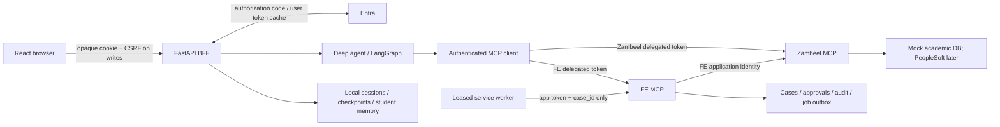

# Ammar: agent, identity and MCP integration

Updated **2026-11-19**. Initial implementation: 2026-11-16. Branch: **ammar**.
Baseline: `8e234b8ed627923c7715be856077d865fbe3bc8b` on main.
Status: agent-side implementation tested locally; live integrated acceptance pending.
Earlier branch contributions: `e49e065` (API boundary), `a4329db` (worker).
Use `git rev-parse HEAD` for the checked-out submission SHA; the final completion
report records it. A commit cannot embed its own SHA.

## 1. Project context and assigned scope

Before this branch the team already had a Deep Agents/LangGraph force-enrollment
agent, read-oriented eligibility sub-agent, synthetic Zambeel database, deterministic
approval/enrollment gates, SQLite checkpoints, per-student memory, audit, two local
MCP servers and React/FastAPI streaming. The main baseline had 240 offline tests.
Those working features are preserved contributions, not newly invented here.

Ammar owns the role originally labelled Saad: trusted agent identity, authenticated
MCP clients, preserved HITL/persistence/security, dashboard integration, recovery
and documentation. Nausherwan owns MCP server internals and currently Entra
administration while Saad is away. Hussain owns Sakai; Yahya owns Oracle/DNS/proxy.
Real PeopleSoft integration remains outside this branch.

This branch adds an optional bearer-verifier foundation, backend-managed browser
login/session/cache, authenticated tool transport, frontend sign-in and recovery
integration, a durable service worker, and tests. It does not claim Nausher's
portal grants are implemented. Nausher's published `e7e3ad6` is now integrated,
including the receiving-side MCP validators, worker endpoint and atomic outbox.
The user's current scope is **force enrollment only**; Sakai and other proposed
automations are outside this increment. See
[infrastructure-crosswalk.md](infrastructure-crosswalk.md) for milestone status.

## 2. Initial architecture versus current architecture

Before: a browser/CLI claimed `S1` or `I1`; API and MCP demo headers trusted those
claims. The agent used local functions, optionally the loopback MCP transport.

The agreed browser design is a BFF (backend for frontend):



Sakai is outside the active force-enrollment scope. No placeholder live Sakai
results are displayed. MCP authorization and the worker endpoint are integrated
from Nausher; actual service provisioning remains a live prerequisite. Deployment
assumes the agreed single VM/shared FE SQLite case database; separate database
hosting would need additional contracts rather than silently copying records.

## 3. Identity and authentication

`api/bff.py:BFF.router` implements `/auth/login`, `/auth/callback`, `/auth/status`
and POST `/auth/logout`. Login uses MSAL ConfidentialClientApplication, auth-code
flow and MSAL's PKCE/state/nonce machinery. The callback is fixed in backend config:
`http://localhost:8000/auth/callback` locally. Redirect destinations never come
from arbitrary request parameters.

A login flow is encrypted server-side, bound to a random HttpOnly login cookie,
expires after ten minutes and is consumed once before the callback exchange.
MSAL verifies the callback protocol; we additionally check the returned ID claims'
tenant, harness audience, issuer, expiry and object ID. The project mapping then
resolves `(tid, oid)` to a supported internal actor/role. Email prefixes, browser
IDs, JWT strings supplied by the browser and model output are not identity sources.

Confirmed synthetic mapping: tenant `305b003b-4966-4335-ae28-1c377e906143`, object
`38ab6ffb-e8b5-424a-8cdd-c88e594cbba8` -> `S1`, Student. The sample mapping is
`seed/entra-users.example.json`. The 19 November shared register additionally
confirms S2, I1 and I2, all present in that mapping. Their Sakai ID cells are empty;
Sakai is not required for this workflow. No passwords are copied into the repo.
BFF role authorization comes from
the operator mapping; MCP APIs independently enforce their resource-specific
scopes/app roles. A harness session does not grant an Instructor role on FE.

An ID token identifies the user to the harness; it is not forwarded to MCP.
`BFF.token` asks MSAL for a delegated **access token for one resource** at a time:
FE uses `api://04ce3e46-2e44-4c4c-949f-09ce52e2a17b/mcp.access`; Zambeel uses
`api://9fd72d08-229f-4b7e-9733-7a23689c4cfa/mcp.access`. Silent acquisition uses
the matching cached account and refresh authorization when possible. Interaction
required returns a sign-in error; it never substitutes an ID token or demo header.
This supersedes the earlier browser-bearer/OBO proposal. OBO is not used here.

`SessionStore` stores encrypted flow/session/cache payloads in a separate SQLite
auth database. Browser cookies are random references, stored only as SHA-256
digests in that database. Sessions last eight hours, with no silent extension.
Fernet authenticates/encrypts payloads; cache changes are serialized in a SQLite
transaction so competing requests do not overwrite refreshed cache contents.
The single-VM implementation bounds MSAL network calls; this is not a distributed
high-throughput session service.

The encryption key must persist across restarts and live outside git. Local
loopback development can create `data/auth.key` once; hosted mode requires a
provisioned protected key. Changing it invalidates sessions, not cases. The local
private configuration/key have user/SYSTEM ACLs on Windows. Production needs
equivalent restricted OS permissions, persistent storage and backup handling.

Cookies are host-only, HttpOnly, SameSite=Lax and Secure in hosted mode. Plain HTTP
is permitted only through explicit loopback development configuration. Every
state-changing browser request requires the session's CSRF token AND an exact
trusted Origin. CORS allows explicit origins with credentials, never a wildcard.
Status returns identity/CSRF only; responses use no-store. Callback responses use
no-referrer, and the provided API launcher disables BFF access logs so auth codes
in query strings are not logged. A hosted proxy must do the same for callback URLs.
Logout removes the local session/cache; it does not sign out every Microsoft app.
The registered loopback flow uses a GET/query callback; MSAL warns that form_post
is preferred. Moving hosted login to form_post requires coordinated callback and
cross-site login-cookie handling, not merely changing an MSAL flag while retaining
the current SameSite=Lax binding cookie. Hosted login has not been live-validated.

`api/auth.py:ApiAuthorization` protects all API reads/writes/streams, checks
resource ownership and rejects conflicting body/path IDs. `context.py` creates a
verified student context with non-secret tenant/object IDs. The legacy isolated
`entra` bearer mode still tests RS256/JWKS, issuer, audience, expiry, scope and role;
it is not the selected browser login mode. Unknown modes fail configuration.

## 4. Agent-to-MCP integration

Existing `read_tools.py`, `write_tools.py` and `clients.py` already called a small
MCP wrapper when enabled. `mcp/client.py` now dispatches authenticated calls to
`mcp/authenticated.py:AuthenticatedMCP`, keeping those tool names/arguments stable.
Only explicit allowed tools remain visible to the agent.

`ApiAuthorization` creates a request-scoped transport capability. It contains a
server-side session reference/token-provider callable, not model-visible tokens.
`app.py:launch` copies context into the detached worker thread; tool/sub-agent
execution inherits the capability. A capability refuses actor/role overrides and
service-key use. `RunTranslator` converts the verified principal into runtime
context. Neither cookie references nor tokens enter messages/checkpoints/memory.

Each call opens an MCP session, initializes it, attaches the intended resource's
bearer token and invokes the tool. HTTPS is required except explicit loopback
development. Redirect following and ambient proxy configuration are disabled.
HTTP timeouts are bounded and possibly completed writes are not blindly replayed.
Unknown transport/protocol/service failures become `MCPUnavailable`, with fixed
sanitized messages. Authentication failures do not cause demo fallback.

`clients.prepare_confirmation` propagates operational failures instead of
interpreting them as student cancellation. Thus a persisted pause can resume after
reauthentication or service recovery. Supported deterministic domain refusals
remain refusals. The stream logs only exception type for authenticated failures,
not OAuth/transport payloads.

Profile now uses Zambeel MCP; student cases and case details use existing FE tools.
`views.remote_case_detail` projects the existing case/audit result to the existing
UI schema (approval and enrollment are reconstructed from recorded audit events).
No new server response schema is invented. Local non-personal catalogue metadata
still supplies section owner display/defense checks; FE authorizes the actual call.

FE has no notification or instructor-list contract in current main. BFF routes
therefore return explicit unavailable responses rather than bypassing FE using
personal SQL reads. Authenticated notification UI is labelled unavailable; an
instructor can open an owned case by ID. Session/checkpoint history and the shared
case state used for graph coordination remain application-local storage. Full
service/database separation is not claimed. Other automations are outside scope.

## 5. LangGraph, sub-agents and HITL

`agent.py:build_agent` uses `create_deep_agent`. The separate eligibility checker
has read-only academic tools and structured output; its context stays small and
it cannot acquire main-agent write permissions. The generic inherited sub-agent
remains disabled. Model instructions never decide whether enrollment is authorized.

Installed HITL middleware matches registered names. Existing MCP wrapper names
already match `submit_case`/`execute_enrollment`; unnecessary renaming would break
resume consumers. Submission pauses for explicit student confirmation; execution
pauses for instructor approval. Write pauses allow approve/reject, not argument
editing or a forged human tool result. Clarification separately permits respond.

The checkpointer retains tool calls/interrupts/thread association across restarts.
Each request supplies authenticated context again. The SSE worker continues when
the browser disconnects; the relay does not own execution. Authentication/CSRF
checks occur before launching streams. Expired sessions cannot send/resume/stop.

In BFF mode instructor decisions call FE with the instructor's delegated token,
then return a decision acknowledgement. They do not resume a student's graph or
use an instructor token as a student credential. FE/outbox and the worker complete
approved enrollment independently.

`reconciliation.py:reconcile_finished` closes a stale execute pause only after an
authoritative terminal case record (and a saved enrollment for COMPLETED) exists.
It writes a deterministic tool outcome/final message and idempotent case note,
without calling a model, executing enrollment or minting approval. Public graph
inspection identifies the terminal node; unsupported graph changes fail review.
BFF checks FE's authorized status before reconciling the shared case record.
Session/history reads perform this repair. React polls without overlapping requests
and reloads the terminal chat so a returning student sees the recovered result.

## 6. Persistence, idempotency and audit

Session ID = thread ID = associated case ID. SqliteSaver stores graph execution;
SqliteStore holds long-term notes under `('students', student_id, 'memories')`.
Protected skills/rules/memories remain read-only to filesystem tools. The notes
writer derives facts from canonical case records, not arbitrary chat instructions.

The existing workflow remains DRAFT -> AWAITING_CONFIRMATION -> SUBMITTED ->
AWAITING_APPROVAL -> APPROVED -> EXECUTING -> COMPLETED, with cancellation,
rejection/failure branches. Its state transitions/audit transactions, instructor
ownership, HMAC signatures, single-use consume, expiry and execution-time academic
rechecks are unchanged. Enrollment is keyed by case ID. A retry reconciles an
already-created enrollment before claiming another write is needed.

`jobs.py` adds a unique job per case with operational metadata only. The integrated
`approvals.record_decision` calls `enqueue_execution` inside the approval transaction,
after its state change but before commit. The helper requires an active transaction
and never commits it.
`worker-handoff.md` gives the exact hook; an outer `with conn` around the existing
`decide` call would NOT suffice because `record_decision` already commits internally.

The worker claims with a short BEGIN IMMEDIATE transaction and fenced lease token,
then releases the DB lock before network I/O. Lease expiry recovers crashes; stale
acknowledgements cannot overwrite a new claimant. Transport/timeouts retry the same
case with capped exponential backoff. An overall deadline bounds service calls.
Authentication/protocol failures become blocked operational jobs, not academic
rejections; operators explicitly retry them after repair. Terminal outcomes retain
an error identifier and case reference. Leases do not replace FE/Zambeel concurrency
and enrollment-idempotency enforcement.

`worker.py:ServiceExecutor` calls only `execute_approved_case(case_id)`, never a
model tool. MSAL client credentials acquire an FE application token independently
of user presence. FE must require `Cases.ExecuteApproved` plus the explicit worker
app identity; FE -> Zambeel uses its separate restricted permission. Those server
endpoints/permissions are not yet published. The 24-hour approval expiry remains
enforced: expired unconsumed approval stops for review, while Entra user-token
expiry does not invalidate a confirmed case. Recovery hooks exist for SUBMITTED
cases but require FE's trusted academic context; the external execution worker
does not invent a student-impersonation routing permission.

## 7. Exact code changes and decisions

| File/group | Change / reason | Verification |
|---|---|---|
| `api/bff.py`, `api/auth.py` | MSAL login, encrypted sessions/cache, CSRF, mapping and route ownership | Mock flow, synthetic RSA, expiry/replay/isolation tests |
| `context.py`, `api/events.py`, `api/app.py` | Verified context, detached-thread propagation, sanitized stream failures, instructor decision separation | Real graph/API and disconnect regression tests |
| `mcp/authenticated.py`, `mcp/client.py`, `clients.py`, `tools/common.py` | Resource tokens, no identity override/fallback, preserve pauses/stop on reauthentication | Fake transport + real MCP regression |
| `api/views.py`, `reconciliation.py` | MCP-backed case projection and deterministic terminal graph/memory repair | Saved enrollment/paused checkpoint tests |
| `jobs.py`, `worker.py` | Outbox, leases, backoff, app token client and recovery | Concurrency/crash/lost-response tests |
| Frontend `App.tsx`, `api/auth.ts`, `api/httpApi.ts`, `api/types.ts` | Sign-in gate, cookie/CSRF transport, stale-response and 401/stream reauthentication reset | Typecheck/build, headless browser smoke |
| Frontend `AppContext.tsx`, `Sidebar.tsx`, `ChatView.tsx` | Fixed authenticated identity, no demo switching, serial polling, recovered outcome display | Browser smoke + review |
| `config.py`, `api/__main__.py` | Explicit private env selection, lazy model startup, suppress callback access logs | Real discovery/redirect and regression |
| `.env.example`, `.gitignore`, `seed/entra-users.example.json`, dependency/lock files | Non-secret setup, ignored local credentials, explicit crypto/MSAL dependencies | Frozen sync, secret/ignore checks |
| `tests/test_api_auth.py`, `test_bff.py`, `test_authenticated_mcp.py`, `test_reconciliation.py`, `test_worker.py`, `browser-auth.cjs` | Meaningful auth/workflow/failure/browser tests | Test commands below |
| Engineering/worker docs, build plan, decisions, crosswalk, frontend README | Explain actual contributions and pending acceptance | Code/contract cross-check |

Chosen alternatives: backend sessions rather than browser bearer/OBO follows the
team's handoff; explicit wrappers rather than blind MCP discovery preserve tool
permissions; existing sync graph/workers rather than an async persistence rewrite
preserve working checkpoints; deterministic reconciliation rather than a worker
LLM avoids giving service credentials a student agent's powers. React review kept
session effects stable and guarded stale asynchronous status responses after logout.

## 8. End-to-end execution trace

**19 November integration:** `test_force_enrollment_stack.py` combines the BFF,
real graph and eligibility subagent, actual HTTP FE/Zambeel services with production
JWT validators, deterministic workflow, durable worker and fresh API/checkpointer
connections. Four cases cover approve/offline/restart, reject, ineligibility despite
a false model verdict, and cancellation. Synthetic Microsoft issuance and scripted
model replies keep this reproducible without credentials. See
[the acceptance report](force-enrollment-acceptance.md) for current results.

The following paragraph records the earlier 16 November tests:

The tested synthetic flow uses a fake MSAL provider, real API/graph/persistence and
explicitly fake MCP transport. Browser login/callback maps S1, cookie+CSRF admit
session creation, and `RunTranslator` passes verified non-secret context. A profile
tool calls Zambeel through the authenticated capability inherited by the worker.

The FE test submits CS412-S1, persists confirmation, and reaches instructor pause.
A simulated FE worker uses the REAL local deterministic approval/enrollment gates.
A timeout after the enrollment write is retried with the SAME case ID; one enrollment
exists and audit integrity passes. Later reconciliation closes the old graph pause
and writes S1's note; S2 cannot see it. A separate API test verifies instructor
decisions call FE and never mint locally or resume the student with instructor auth.

These tests do not claim real Microsoft token issuance or a live authenticated FE
endpoint. The real discovery/login redirect check reached Microsoft's authority,
but no interactive callback/token exchange or full live enrollment was completed.

## 9. Testing and correctness

Current 19 November regression: **354 passed, 11 live tests deselected**, 181.04
seconds; frontend typecheck/build passed. See the acceptance report for the four
new full-stack cases and what remains simulated. The figures below are history.

Baseline: 240 passed, 11 live deselected. First API increment: 253 full-suite passes;
worker increment: 286 full-suite passes plus final 32 focused worker passes.
The 16 November BFF increment's final post-review run: **315 passed, 11 live deselected**,
140.17 seconds (`uv run pytest -q -m "not live"`). Frozen sync, frontend typecheck
and build, and the headless browser auth smoke passed. Real configuration returned
200 BFF status and a 302 redirect to Microsoft's authority. No interactive
callback/token exchange, live model or authenticated university-service acceptance
is claimed. Final submission SHA is in the completion report/Git history.

Tests catch forged/wrong-resource/expired bearer credentials; missing roles/scopes;
unmapped users; callback state mismatch, absent binding cookie and replay; CSRF and
Origin mismatch; cookie/cache tampering; cache survival and concurrent updates;
student/instructor impersonation; pre-stream refusal; safe operational retry;
separate MCP tokens, no actor override or demo fallback; and no credentials in
checkpoint messages. Existing approval/academic race/HITL/sub-agent tests remain.
Worker tests specifically catch a write completed before response loss and stale
lease acknowledgement. Reconciliation refuses APPROVED as if it were COMPLETED.

The optional Playwright smoke uses fake auth/API responses against the real built
React UI: sign-in gate, mapped S1/no switcher, CSRF logout, 401 clearing and mobile
overflow. It is not live Entra acceptance. Frontend typecheck/build pass. Integrity
checks on the newly initialized local simulator pass (zero cases at bootstrap).
The model-dependent tool-list script requires HARNESS_MODEL; no live model settings
were provided. Equivalent tool-permission tests use the installed graph offline.

## 10. Supervisor questions and engineering answers

- **How does MCP know the student?** It must validate its resource-specific token
  and map verified tenant/object ID. The model never chooses a student argument.
- **Why both API and MCP authorization?** The API protects its sessions/history;
  each service independently protects its records and business operations.
- **Why not send ID tokens?** Their audience is the harness. MCP requires its own
  access token and scope/role checks; one API token cannot stand in for another.
- **What if user tokens expire?** MSAL attempts renewal from its encrypted cache;
  interaction-required asks for sign-in again. The saved case is not cancelled.
- **What if the student goes offline?** The agreed worker uses app credentials and
  saved approval; endpoint/outbox integration is implemented. Actual app credentials
  and Entra grants are needed for live operation, independently of student tokens.
- **What if MCP goes down?** Retry/reload preserves case ID/checkpoint. Worker
  transport errors back off; unknown/auth failures are operational review items.
- **Why isn't HITL authorization?** A human pause alone cannot enforce instructor
  ownership, signature, expiry, consume-once or changed academic eligibility.
- **How do restarts work?** Cases, checkpoints, encrypted sessions/cache and job
  leases persist. Keep the encryption key. Worker recovery does not rely on cookies.
- **Why no write tools for sub-agents?** Tool allowlists enforce separation even
  if instructions/model output are wrong. The worker endpoint is never model-visible.
- **What remains external?** Actual v2 tokens/service grants and credentials,
  model configuration and hosted/live acceptance. Four test users are provisioned.
  Notification/instructor-list contracts remain a UI gap; owned cases open by ID.
  Sakai and other automations are outside this increment.

## 11. Running and demonstrating

From repo root, PowerShell:

```powershell
uv sync --frozen
uv run pytest -q -m "not live"
uv run pytest -q tests/test_bff.py tests/test_authenticated_mcp.py tests/test_reconciliation.py tests/test_worker.py
# Private local BFF config is ignored. Supply HARNESS_CLIENT_SECRET securely.
$env:HARNESS_ENV_FILE = '.env.bff.local'
uv run python -m harness.api
# In a separate terminal:
cd frontend
$env:VITE_USE_MOCK = 'false'
$env:VITE_API_BASE_URL = 'http://localhost:8000'
npm ci
npm run typecheck
npm run build
npm run dev -- --host localhost
```

Use localhost consistently with the registered callback. Open localhost:5173 and
sign in as the mapped project account. Model settings are still required to run
an actual agent; login itself starts lazily without fabricating a model. For a
new simulator only, `uv run python scripts/seed.py --db data/harness.db` seeds it
and refuses an existing file. Never use --reset on records that must be preserved.

Existing DEMO services run in separate terminals with demo configuration:
`uv run python -m harness.mcp fe` and `uv run python -m harness.mcp zambeel`.
Select `HARNESS_MCP_AUTH_MODE=demo` explicitly for those demo servers. For the
integrated Entra servers, use separate private environments configured according
to [entra-mcp.md](entra-mcp.md), with `HARNESS_MCP_AUTH_MODE=entra`. Authenticated
clients never fall back to demo identity. Worker commands and the implemented
approval hook are in [worker-handoff.md](worker-handoff.md).

Optional browser smoke: build with VITE_USE_MOCK=false, make Playwright available
to Node, then `node tests/browser-auth.cjs` (PLAYWRIGHT_CHANNEL=msedge is supported).
It starts/stops its own preview and explicitly intercepts fake authentication/API.

Hosted mode requires HTTPS, secure cookies, exact origins/redirects, protected
persistent key/cache files and a single API process for the current run locks.
Do not share the private config or copy backend secrets into VITE variables.

## 12. Submission and limitations

Submit only `origin/ammar`; main remains unchanged. Local `.env.bff.local`, auth
database/key, synthetic simulator and browser screenshots are ignored. The supplied
harness secret is private backend configuration; expiry reported as 2027-05-15.

Implemented agent-side code is locally verified. Full live completion remains
dependent on private worker/FE credentials and actual service grants, v2 API
tokens, model settings and real callback/role/deployment acceptance. Nausher's
authenticated endpoints, atomic handoff and FE submission recovery are integrated;
four student/instructor identities are mapped. Sakai is outside the active scope.
Notifications/instructor lists are explicitly unavailable in BFF mode until an
agreed server interface exists. API and FE currently share the simulator database
for case/checkpoint coordination. Those limitations must be stated in the demo.
No mock, redirect-only check or offline success is labelled full live acceptance.
