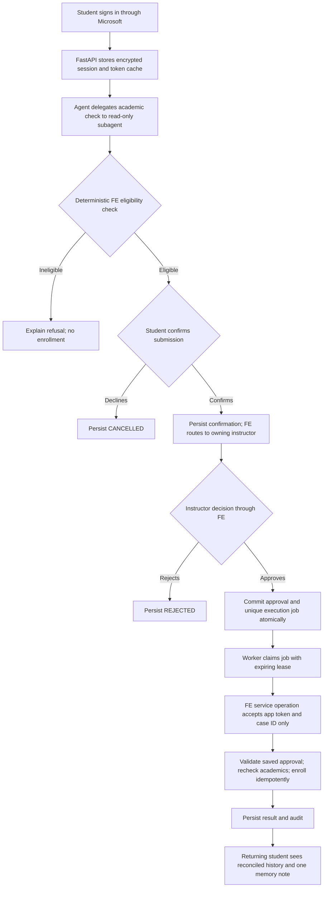

# Force enrollment: scope, acceptance and remaining work

Updated 19 November 2026. Branch: `ammar`. Baseline main: `8e234b8`.

## Scope and ownership

Force enrollment is the **only automation in this increment**, per Ammar's latest
instruction. Follow his assigned Agent/Orchestrator role (originally Saad's):
verified identity, authenticated MCP calls, preserved tool boundaries/HITL,
persistence/recovery, tests and execution documentation. Sakai, advising, TA-ship,
Outlook and other proposed automations are not prerequisites for this workflow.
Academic data and FE rules remain synthetic team fixtures, not university policy.

Reuse the existing agent, eligibility subagent and deterministic workflow. Ammar's
BFF/client/worker implementation is preserved. Nausher's published `e7e3ad6`, based
on our `74bf873`, was fast-forwarded into `ammar`; main was not changed. His
receiving-side MCP authentication, service endpoint, atomic approval/outbox and
FE recovery are integrated contributions, not outstanding code requests to him.

## Current workflow



The browser receives an opaque cookie, never an MCP access token. FastAPI acquires
a separate delegated token for each resource. Instructor credentials record the
decision; they never resume a student agent as the student. After approval, the
worker uses its own FE application token. FE uses its separate Zambeel application
token, deriving the student/section from saved records. The worker is not a model
tool and cannot override those records. No delegated token is stored in the job
or graph checkpoint.

Student sign-out/token expiry does not cancel saved confirmation or approval.
FE recovers confirmed SUBMITTED cases; workers reclaim expired leases and retry
the same case after ambiguous transport failures. Same-case database coordination
and enrollment idempotency protect against duplicate writes. A saved case and its
audit survive restarts. Expired **unconsumed approval** still stops for instructor
review after 24 hours; this is distinct from student Entra-token expiry.

## Verified locally

19 November Windows verification:

| Check | Result |
|---|---|
| Frozen dependency synchronization | Passed |
| Full offline regression | **354 passed, 11 live tests deselected**, 181.04 seconds |
| New full-stack file alone | **4 passed**, 15.92 seconds |
| Frontend TypeScript checks | Passed |
| Frontend production build | Passed |

The suite emits one existing SDK/Pydantic settings annotation warning; it does not
fail the checks. These results do not claim real Microsoft token issuance, a real
model run, a hosted deployment or real university enrollment.

`tests/test_force_enrollment_stack.py` uses production BFF routes/session storage,
the installed graph and subagent, real loopback HTTP FE/Zambeel MCP services,
production signed-JWT validators, the deterministic workflow/academic database,
durable worker and persistent checkpoints/memory. Microsoft login/token issuance
is replaced by a synthetic provider and locally signed tokens; model responses
are scripted. The HTTP tool operations and database effects are not fabricated.

| Scenario | Assertions |
|---|---|
| Approval with student offline and restart | Student confirms; I2 and student approval attempts fail; I1 approval creates one job without resuming student graph. Remove S1 session/cache, abandon a claimed lease, recover with a new worker connection, complete via service-only HTTP operation. A duplicate execute returns the saved enrollment. Rebuild API/auth store/checkpointer connections, sign in again, reconcile without any model reply: one enrollment, one S1 note, no pending graph pause, intact audit. |
| Instructor rejection | Instructor decision persists REJECTED; no enrollment; fresh API/history reconciliation closes the old pause and records one note. |
| Ineligible student | S2 lacks the prerequisite. Even a scripted subagent claiming eligibility cannot make FE create a case or enrollment. |
| Student cancellation | Decline confirmation; persist CANCELLED and a case-derived note; no approval, job or enrollment. |

Cross-user case/memory access and browser impersonation attempts are also refused.
`tests/test_mcp_entra.py` separately covers invalid tokens/roles/audiences, app
allowlists, atomic transaction rollback, concurrent execution, process-death lock
release, lost-response retry, SUBMITTED recovery, expired approval and academic
rejection. Existing tests retain HITL/tool isolation, cache/CSRF/replay, races,
checkpoint/memory, browser-disconnect and audit guarantees.

The full-stack restart rebuilds API/persistence objects in one test process; it
does not simulate a machine reboot. Process-death locking is separately tested.
The supported deployment remains one VM/shared local SQLite filesystem and one
API process for in-process run locks. This is not a multi-host design.

## Confirmed accounts

The shared account register was checked on 19 November. Its Test Accounts tab
confirms S1, S2, I1 and I2 and matches `seed/entra-users.example.json`. Students
are listed with Student roles on both MCPs; instructors with Instructor on FE
and no Zambeel role. Actual token-role issuance still needs live verification.
All four Sakai-ID cells were empty when read; that does not block force enrollment.
Passwords are not copied into this repository or report.

## What remains

1. **Provision private service configuration locally.** No worker client ID/secret,
   FE client secret or model settings are configured in the current selected
   private file/process. The existing harness login credential cannot stand in
   for those separate identities. Securely supply the dedicated worker credential,
   FE credential and a supported model/provider configuration.
2. **Confirm actual Entra grants/manifests.** Both MCP APIs must issue v2 access
   tokens. Worker needs FE `Cases.ExecuteApproved`; FE needs Zambeel `Academic.Read`
   and `Enrollment.ExecuteApproved`, with admin consent and matching explicit
   application allowlists. Account provisioning/delegated consent does not prove
   these application grants exist. This report does not claim they are absent
   from the tenant; they have not been verified with actual issued tokens here.
3. **Run live acceptance.** Complete real S1 login/callback, actual model eligibility
   and student confirmation, I1 approval, worker completion with the student
   offline and API restart, then verify one enrollment/audit/note. Repeat negative
   ownership/isolation, rejection, expiry and recovery checks using real accounts.
   Preserve the simulator state; use a new dedicated acceptance database rather
   than resetting existing cases.
4. **Resolve the remaining FE UI interface gap.** Notification and instructor-list
   MCP contracts are absent. Authenticated instructors can open an owned case by
   ID; lists/notifications deliberately report unavailable. Agree the server
   operations before connecting them; do not bypass authorization using personal
   SQL reads. This is a known demonstration limitation.
5. **Deploy/supervise and verify the target host.** Preserve the approval secret,
   case/outbox DB, checkpoints, memory and encrypted auth key/store. Configure
   separate private process environments, HTTPS/exact callback/origins and a
   supervised worker. Verify restart/lease recovery on that host. Expired approval
   is retained for review; an explicit renewed-approval flow is not implemented.

Sakai dashboards and other automations are outside this list by current scope.

## Reproduce the local checks

From the repository root in PowerShell:

```powershell
uv sync --frozen
$env:HARNESS_AUTH_MODE = 'demo'
$env:HARNESS_MCP_AUTH_MODE = 'demo'
$env:HARNESS_USE_MCP = 'false'
uv run --frozen pytest -q tests/test_force_enrollment_stack.py tests/test_mcp_entra.py
uv run --frozen pytest -q -m 'not live'
cd frontend
npm ci
npm run typecheck
npm run build
```

The auth fixtures select Entra mode inside their tests; the outer demo flags keep
unrelated regression tests independent of private shell configuration. Tests use
temporary databases and do not need Microsoft passwords or model credentials.

For actual execution use fresh terminals, not these demo overrides. Follow the
[root README](../README.md#installation-and-execution) for BFF/frontend/worker
commands and [Entra MCP runbook](entra-mcp.md) for per-service configuration and
permissions. `HARNESS_ENV_FILE` selects each process's private file; it does not
merge credentials from other files. No secret belongs in a `VITE_` variable.
